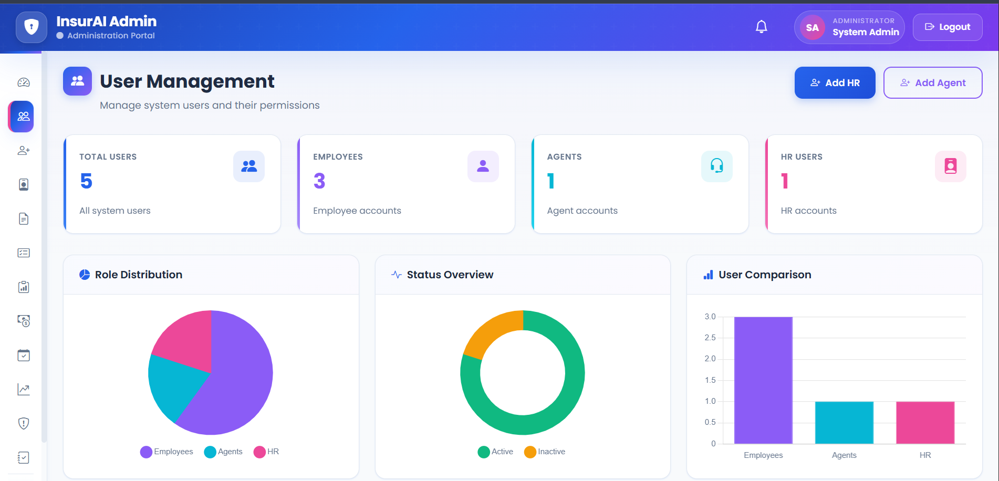
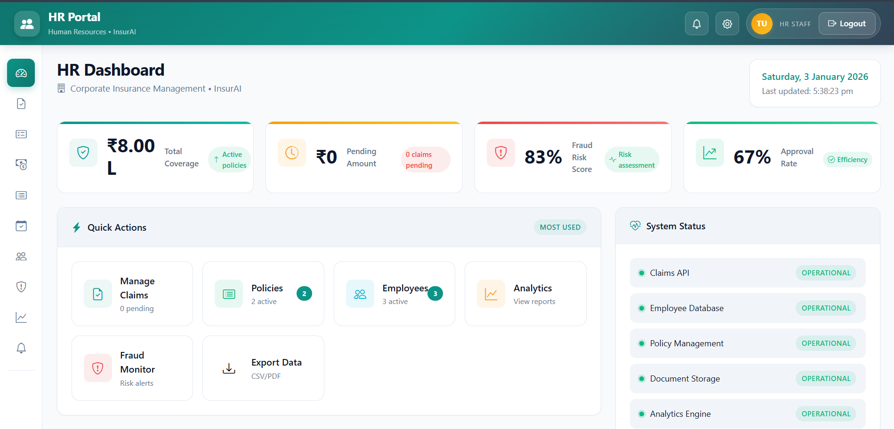
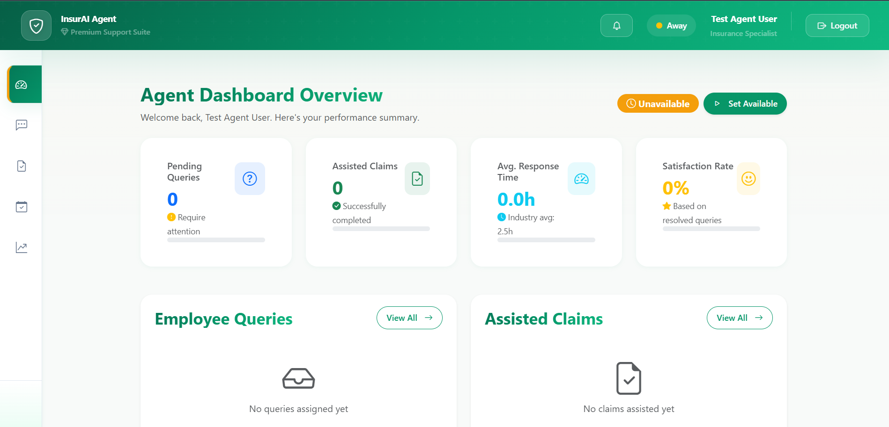
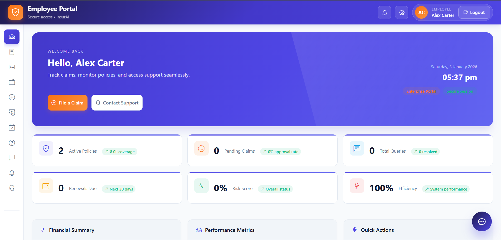
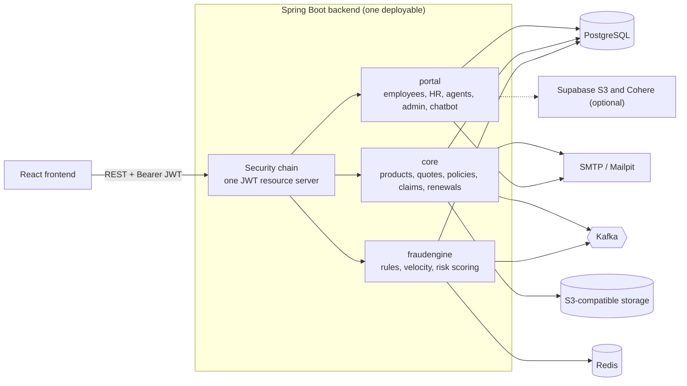

# InsurAI Platform

One Spring Boot application and one React frontend that bring together three insurance systems that were built
separately:

| Module | What it is | Package |
| --- | --- | --- |
| **portal** | Corporate insurance portal. Employees, HR, agents and an admin; claim submission and HR approval, enrolment, reimbursement, renewals, an AI chatbot, in-app notifications, audit log. | `com.insurai.platform.portal` |
| **core** | Policy and claims engine. Versioned products and explainable rating, idempotent bind-and-pay, bitemporal policies, claim triage with straight-through settlement, a fraud-signal graph, partitioned renewal batches, transactional outbox. | `com.insurai.platform.core` |
| **fraudengine** | Real-time transaction fraud pipeline. Kafka ingestion, rules + Redis velocity + weighted scoring, PASS/BLOCK decisions, live WebSocket alerts, nightly Spring Batch report. | `com.insurai.platform.fraudengine` |

They share one deployable, one PostgreSQL database, one Kafka and Redis, one identity (a token issued at portal
login is accepted by every module) and one observability stack. They remain separate bounded contexts: an
ArchUnit test fails the build if one module starts importing another.

> **Status of the merge.** See [docs/MERGE-NOTES.md](docs/MERGE-NOTES.md) for exactly what was combined, what was
> changed and why, what was verified and what has not yet been run.

## Screenshots (portal)

| Admin | HR | Agent | Employee |
| --- | --- | --- | --- |
|  |  |  |  |

## Architecture



More detail, including data ownership, messaging and the design decisions, in
[docs/ARCHITECTURE.md](docs/ARCHITECTURE.md).

## Run it

Needs Docker with Compose v2, plus `curl`, `jq` and `openssl` for the scripts.

### Full stack

```bash
./scripts/up.sh            # builds both images, writes random secrets to ~/.config/insurai-platform/compose.env, starts everything
./scripts/demo.sh          # end-to-end walkthrough with assertions
MONITORING=1 ./scripts/up.sh   # same, plus Prometheus, Tempo and Grafana
docker compose --env-file ~/.config/insurai-platform/compose.env down -v
```

`up.sh` prints the generated portal admin login the first time it runs (it is also stored in the env file).

| What | Where |
| --- | --- |
| Frontend | http://localhost:5173 |
| Backend API | http://localhost:8080 |
| Mailpit (every e-mail the platform sends) | http://localhost:8025 |
| Object storage (S3 API) | http://localhost:9000 |
| Grafana / Prometheus (with `MONITORING=1`) | http://localhost:3000 / http://localhost:9090 |
| Kafka UI, RedisInsight (`docker compose --profile tools up -d`) | http://localhost:8081, http://localhost:5540 |

Every port is bound to `127.0.0.1`.

### Develop from your IDE

Run only the infrastructure in Docker, the backend on the host. The `local` Spring profile (active by default)
carries development-only values that match `.env.example`.

```bash
cp .env.example .env
docker compose up -d postgres redis kafka s3 mailpit
cd backend && mvn spring-boot:run          # http://localhost:8080
cd frontend && npm ci && npm run dev       # http://localhost:5173
```

With the `local` profile, Swagger UI (`/swagger-ui.html`) and the fraud dashboard (`/dashboard.html`) are open
without a token. In any other profile they are closed unless you set `PLATFORM_OPEN_DEV_ENDPOINTS=true`.

## One identity across modules

Logging in through the portal (`/auth/login`, `/admin/login`, `/hr/login`, `/agent/login`) returns a JWT
(HS256, `sub` = e-mail, `role` claim, issuer `insurai-platform`). Every module validates that same token with one
Spring Security resource-server chain, so the API clients and the UI use a single credential.

| Portal role | Portal access | In `core` (`/v1/**`) | In `fraudengine` (`/api/v1/**`) |
| --- | --- | --- | --- |
| ADMIN | `/admin/**` | MANAGER | transactions and reports |
| HR | `/hr/**` | ASSESSOR | none |
| AGENT | `/agent/**` | AGENT | none |
| EMPLOYEE | `/employee/**` | CUSTOMER (own policies and claims only) | none |

In `core`, an explicit assignment in the staff table (`/v1/staff`) always wins over the token's role, and a role
claim is honoured only on tokens from this platform's issuer.

Authorisation is deny-by-default: any route not listed in
[`PlatformSecurityConfig`](backend/src/main/java/com/insurai/platform/security/PlatformSecurityConfig.java) is
refused. The portal controllers keep their own in-method role checks as a second layer.

## Configuration

Everything is environment-driven; there are **no default secrets** outside the `local` profile, so a deployment
that forgets one fails to start rather than running with a known value.

| Variable | Purpose |
| --- | --- |
| `PLATFORM_JWT_SECRET` | Signs every token. At least 32 characters. |
| `PLATFORM_ADMIN_EMAIL`, `PLATFORM_ADMIN_PASSWORD` | Bootstrap portal administrator. |
| `PLATFORM_DB_URL`, `PLATFORM_DB_USER`, `PLATFORM_DB_PASSWORD` | PostgreSQL. |
| `PLATFORM_REDIS_HOST`, `PLATFORM_KAFKA` | Redis and Kafka. |
| `PLATFORM_S3_*`, `PLATFORM_PARTY_HMAC_KEY` | Core object storage; key for hashing party identifiers. |
| `FRAUD_ADMIN_TOKEN` | Shared secret for `/api/v1/admin/**` (`X-Admin-Token`). |
| `PLATFORM_CORS_ORIGINS` | Browser origins allowed to call the API. |
| `PLATFORM_SMTP_*` | Outgoing mail (Mailpit by default). |
| `SUPABASE_*`, `COHERE_API_KEY` | Optional portal integrations; leave empty to run without them. |

Full list with defaults: [`application.yml`](backend/src/main/resources/application.yml) and
[`.env.example`](.env.example). Frontend: `VITE_API_BASE_URL` (build time), see
[`frontend/.env.example`](frontend/.env.example).

## Tests

```bash
cd backend
mvn test       # unit and architecture tests (no Docker): rating, pipeline, identity contract, module boundaries
mvn verify     # + integration tests with Testcontainers (Docker required): Postgres, Redis, Kafka, Mailpit, S3
```

What the suites cover, by origin: **core** has unit and ArchUnit tests plus integration tests for concurrent
binds and endorsements, idempotent replay, double settlement, renewal reruns, the outbox relay and duplicate Kafka
deliveries; **fraudengine** has pipeline unit tests (with an 85% line-coverage gate on the pipeline and
orchestration) plus Kafka, Redis, Postgres and batch integration tests; **platform** tests pin the identity
contract (a portal-issued token is accepted by the platform decoder; forged, expired and foreign-issuer tokens are
rejected; role mapping) and the module boundaries.

## Repository layout

```
backend/              Spring Boot application (Maven, Java 21)
  src/main/java/com/insurai/platform/
    PlatformApplication.java   the single entry point
    security/                  shared kernel: JWT validation, the one security chain
    config/                    shared kernel: Kafka producer defaults
    portal/  core/  fraudengine/
  src/main/resources/db/migration/   V1 core, V2 Spring Batch, V3 fraud engine
frontend/             React + Vite single-page app (the portal UI)
monitoring/           Prometheus, Tempo, Grafana provisioning and the fraud dashboard
scripts/              up.sh, demo.sh, bench.sh, load-test.sh, export-portal-schema.sh
docs/                 ARCHITECTURE.md, MERGE-NOTES.md, per-module notes
```

## Documentation

- [Architecture](docs/ARCHITECTURE.md): how the pieces fit, data ownership, messaging, decisions.
- [Merge notes](docs/MERGE-NOTES.md): what changed from the three originals, the migration map, known gaps.
- Module notes: [portal](docs/modules/portal.md), [core](docs/modules/core.md), [fraud engine](docs/modules/fraud-engine.md).
- [Contributing](CONTRIBUTING.md) and [Changelog](CHANGELOG.md).

## Known limitations

Each module documents its own (see the module notes). The ones that matter most at platform level:

- **The portal's tables are still created by Hibernate** (`ddl-auto=update`); Flyway owns the core and fraud
  tables. `scripts/export-portal-schema.sh` turns the portal's real schema into a migration so Flyway can own
  everything; see [MERGE-NOTES](docs/MERGE-NOTES.md#database).
- **The portal and core each have their own claim workflow** (HR approval versus rule-based triage). They are
  not yet unified.
- **No UI for the core and fraud APIs.** They are reachable with a portal token (Swagger UI in `local`, or the
  scripts); the React app covers the portal only.
- **Uploaded claim documents are served without authentication** (`/api/files/**`, `/uploads/**`), as in the
  original portal, because the UI opens them with plain links.
- **`GET /notifications/user/{id}` does not check that `{id}` is the caller.** Any signed-in user can read
  another's notifications. Carried over from the original portal.
- `spring-webmvc` 6.2.x has two open CVEs with fixes only in 7.0. They need XSLT views or view fragments over
  SSE, which none of the modules use; they are waived in `.trivyignore` until a move to Spring Boot 4.
