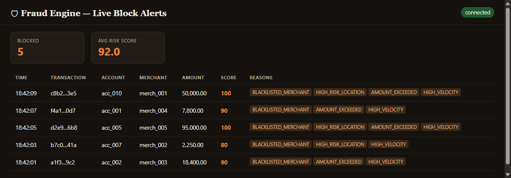
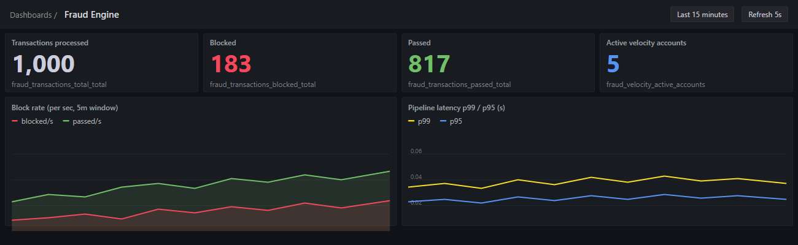

# Fraud engine module

A real-time transaction fraud engine: a **rules + velocity + weighted-score pipeline that decides PASS or BLOCK**,
the kind of system a payment processor uses to approve or block a transaction in milliseconds. Idempotent,
asynchronous, observable, with a hexagonal domain that has no framework dependencies.

## How a transaction flows

```
                 ┌────────────┐   202 Accepted
   client ─POST─▶│   REST     │──────────────────────▶ caller polls GET /{id}
                 │ Controller │
                 └─────┬──────┘
                       │ publish
                 ┌─────▼───────────────┐
                 │ Kafka                │  transactions.incoming (3 partitions)
                 └─────┬───────────────┘
                       │ consume (manual ack, idempotent)
        ┌──────────────▼───────────────────────────────────────┐
        │  Fraud pipeline (domain: pure Java)                   │
        │                                                       │
        │  RulesEngine ─▶ VelocityChecker ─▶ RiskScorer ─▶ DecisionEngine
        │   (blacklist,    (Redis INCR+TTL)   (weighted)    (threshold)
        │    limit, geo)                                        │
        └───────┬──────────────────┬───────────────┬───────────┘
                │ audit             │ if BLOCK      │ if BLOCK
          ┌─────▼─────────┐  ┌──────▼──────┐   ┌────▼──────────┐
          │ PostgreSQL    │  │   Kafka     │   │  WebSocket    │
          │ fraud_audit_  │  │  .flagged   │   │  /topic/...   │
          │ log           │  └─────────────┘   └───────────────┘
          └───────────────┘
```

## Scoring model

| Signal | Weight |
|---|---|
| Blacklisted merchant | 40 |
| High velocity (more than 10 transactions in 5 minutes) | 30 |
| Amount exceeds the account's daily limit | 20 |
| High-risk location | 10 |

The score is the sum of triggered weights, clamped to 100. **Score ≥ 75 means BLOCK**, otherwise PASS. Weights and
threshold are configuration (`fraud.weights.*`, `fraud.threshold`, `fraud.velocity.*` in `application.yml`), so
the business can tune them without a code deploy.

## Using it

These endpoints need an **ADMIN** token (any portal admin login works). `scripts/lib.sh` has helpers that read
the generated secrets:

```bash
source scripts/lib.sh
TOKEN=$(login_admin)

curl -X POST http://localhost:8080/api/v1/transactions \
  -H "Authorization: Bearer $TOKEN" -H "Content-Type: application/json" \
  -d '{"transactionId":"11111111-1111-1111-1111-111111111111","accountId":"acc_001","amount":100.00,
       "currency":"USD","merchantId":"merch_999","merchantName":"Clean Store",
       "location":"United States","timestamp":"2026-05-30T12:00:00Z"}'
# 202 Accepted; the decision is ready a moment later:
curl -H "Authorization: Bearer $TOKEN" http://localhost:8080/api/v1/transactions/11111111-1111-1111-1111-111111111111
```

**See a BLOCK.** The seeded account `acc_010` has a 1,000 daily limit, `merch_001` is blacklisted and `Nigeria` is
a high-risk location. Eleven transactions in a row trip all four signals (the 11th crosses the velocity window),
score 100 and BLOCK. With `PLATFORM_OPEN_DEV_ENDPOINTS=true` (the `local` profile, or add it to the env file and
rerun `scripts/up.sh`) the live dashboard at `/dashboard.html` shows each block within about a second and
`transactions.flagged` receives the event:

```bash
for i in $(seq 1 11); do
  curl -s -X POST http://localhost:8080/api/v1/transactions \
    -H "Authorization: Bearer $TOKEN" -H "Content-Type: application/json" \
    -d "{\"transactionId\":\"$(uuidgen)\",\"accountId\":\"acc_010\",\"amount\":50000,\"currency\":\"USD\",\"merchantId\":\"merch_001\",\"merchantName\":\"Dodgy\",\"location\":\"Nigeria\",\"timestamp\":\"$(date -u +%Y-%m-%dT%H:%M:%SZ)\"}" > /dev/null
done
```



**Nightly report.** Spring Batch runs it at midnight; trigger one by hand with the admin header:

```bash
curl -X POST "http://localhost:8080/api/v1/admin/reports/trigger?date=2026-05-30" -H "X-Admin-Token: $FRAUD_ADMIN_TOKEN"
curl -H "Authorization: Bearer $TOKEN" "http://localhost:8080/api/v1/reports?date=2026-05-30"
```

**Monitoring.** `MONITORING=1 scripts/up.sh` adds Prometheus, Tempo and Grafana; the *Fraud Engine* dashboard (block
rate, pipeline p95/p99, active velocity accounts) is provisioned automatically.



## Layers

Code lives in `backend/src/main/java/com/insurai/platform/fraudengine`.

```
api/             Inbound adapters: REST controllers, STOMP WebSocket handlers, exception advice.
application/     Use-case orchestration. Wires domain pipeline stages and ports. Thin.
domain/
  model/         Immutable records (TransactionRequest, Transaction, FraudDecision, AuditRecord).
  pipeline/      RulesEngine, VelocityChecker, RiskScorer, DecisionEngine. Pure. No Spring.
  ports/         Outbound interfaces the domain depends on (AuditPort, VelocityPort, ...).
  exception/     FraudEngineException hierarchy.
infrastructure/  Outbound adapters implementing ports: kafka/, redis/, persistence/, websocket/.
batch/           Spring Batch FraudReportJob (reader → processor → writer).
config/          @Configuration: Kafka topics, Redis template, WebSocket broker, OpenAPI, metrics.
```

Dependency direction: `api`/`infrastructure` → `application` → `domain`. The domain never imports
outward. Adapters implement domain ports.

## The pipeline (request lifecycle)

1. **Ingest** — `POST /api/v1/transactions` validates the request (Bean Validation), publishes
   `TransactionRequest` to `transactions.incoming`, returns `202 {status: PROCESSING}`.
2. **Consume** — `@KafkaListener` (manual ack, `max-poll-records=10`). Idempotency check on
   `transactionId`; already-processed → skip.
3. **Rules (Stage A)** — blacklist (Redis set), daily-limit (Postgres `fraud_account_limits`),
   high-risk location (Redis set) → `List<RuleViolation>`.
4. **Velocity (Stage B)** — Redis `INCR fraud:velocity:{accountId}` with first-write TTL; count
   over threshold raises `HIGH_VELOCITY`.
5. **Score (Stage C)** — `RiskScorer` sums weights, clamps to 100 (pure function).
6. **Decide** — `DecisionEngine`: `score >= threshold ? BLOCK : PASS`.
7. **Persist** — write `fraud_audit_log` with score, decision, reasons (JSONB).
8. **React** — on BLOCK: publish to `transactions.flagged` and push a WebSocket alert.
9. **Poison messages** — unrecoverable failures route to `transactions.incoming.DLT`.

## Data model

- `fraud_audit_log` — one row per evaluated transaction (idempotency via unique `transaction_id`).
- `fraud_account_limits` — per-account daily spend ceiling.
- `fraud_reports` — one row per nightly batch run.

Redis keys: `fraud:blacklist:merchants` (set), `fraud:locations:high_risk` (set),
`fraud:velocity:{accountId}` (counter w/ TTL).

Kafka topics: `transactions.incoming` (3 partitions), `transactions.flagged` (1),
`transactions.incoming.DLT` (1).

## Performance target

End-to-end pipeline latency p99 < 200ms, measured with `scripts/load-test.sh` (it logs in through the portal and posts transactions as an admin). It was measured on the standalone engine; it has not been re-measured on the combined application.

Account daily limits are cached (Spring Cache, in-memory) since they change rarely and
are read on every transaction — this removes a database round trip from the hot path.

## Known limitations & trade-offs

Deliberate choices, called out so they are not mistaken for oversights:

- **Velocity active-accounts gauge** uses a `SCAN` over `fraud:velocity:*` on every Prometheus
  scrape. Fine at demo scale; at millions of keys this is O(N) per scrape and should be replaced
  with an approximate counter or a maintained set.
- **Velocity can over-count under Kafka redelivery.** If a redelivery arrives before the first
  attempt's audit row commits, the idempotency check (`existsByTransactionId`) misses and the
  Redis counter increments twice. The unique constraint on `fraud_audit_log.transaction_id` still
  prevents a duplicate decision; only the velocity metric is briefly inflated. A dedup store with
  TTL would close this fully.
- **Nightly report buckets by `created_at::date` in the server timezone.** Transactions near
  midnight across timezones could land in an adjacent day's report. Acceptable for a daily summary;
  a fixed reporting timezone would make it exact.
- **`/api/v1/admin/**` is guarded by a shared-secret header** (`X-Admin-Token` = `FRAUD_ADMIN_TOKEN`), kept from the
  original for service-to-service use. The ingestion and report-read APIs now require an ADMIN token from the
  platform, but there is no per-user RBAC beyond that.
- **WebSocket alerts use the in-memory STOMP broker**: single-instance only, and the dashboard and socket are open
  only when `PLATFORM_OPEN_DEV_ENDPOINTS` is on (the browser WebSocket API cannot send an `Authorization` header). Multi-instance needs
  a broker relay or Redis pub/sub bridge (noted in `WebSocketConfig`).

The engine's design rationale (why Kafka, why Redis `INCR` + TTL, why idempotency on `transactionId`, ...) is in
[ARCHITECTURE.md](../ARCHITECTURE.md#decisions-carried-over-from-the-originals).
